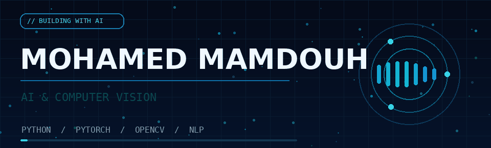

# Mohamed Mamdouh

**Computer Science & Artificial Intelligence student · Expected graduation: 2027**

**Computer Vision** · **Deep Learning** · **Machine Learning** · **Natural Language Processing**

[LinkedIn](https://www.linkedin.com/in/mohamed-mamdouh-317643289/) · [GitHub repositories](https://github.com/mohamedmamdouh1805?tab=repositories)

## 👨‍💻 About me

I'm **Mohamed Mamdouh**, a Computer Science and AI student at **King Salman International University, Egypt**, expecting to graduate in **2027**. I enjoy turning AI concepts into practical applications—from preparing datasets and evaluating models to building usable interfaces.

- 🔭 Focus: **AI engineering, computer vision, deep learning, and applied NLP**
- 🧪 Projects: image classification, detection and tracking, visual retrieval, and Arabic text classification
- 🎯 Open to: **AI / ML / Computer Vision internships and junior opportunities**
- 📍 Egypt

<!-- Portrait placeholder: Add a real portrait at assets/profile.jpg, then insert it here with the alt text "Mohamed Mamdouh". -->

## 🛠️ Technical toolkit

- **Languages:** Python · C++
- **AI & Deep Learning:** PyTorch · Torchvision · TensorFlow (coursework) · Scikit-learn · Classification · Regression · Model Evaluation · CNNs · Transfer Learning
- **Computer Vision:** OpenCV · YOLO · ByteTrack · Image Processing · Perspective Correction · Image Embeddings
- **NLP & Data:** TF-IDF · Arabic Text Preprocessing · Sequence Models · NumPy · Pandas · Matplotlib
- **Development:** Streamlit · Git · GitHub
- **CS foundations:** Data Structures & Algorithms · OOP · Databases · Operating Systems · Networks · Software Engineering · Data Mining

## 🚀 Featured AI projects

| Project | What it does | Stack |
|:--|:--|:--|
| 🔬 **[Industrial Surface Defect Detection](https://github.com/mohamedmamdouh1805/industrial-defect-detection)** | Classifies six steel-surface defect types; trained CNN and MobileNetV3-Small classifiers. | PyTorch · Transfer Learning · Streamlit |
| 🩺 **[Anesthesia Decision Support System](https://github.com/mohamedmamdouh1805/anesthesia-decision-support)** | Educational research prototype for general anesthesia type prediction and numeric dosage estimation, with an interactive dashboard. | CatBoost · TensorFlow/Keras · Streamlit · Plotly |
| 🎯 **[Object Detection, Tracking & Counting](https://github.com/mohamedmamdouh1805/object-detection-tracking-counting)** | Tracks objects across video frames, counts line crossings, and exports annotated video and CSV counts. | YOLO11n · ByteTrack · OpenCV · Streamlit |
| 📄 **[Smart Document Scanner](https://github.com/mohamedmamdouh1805/smart-document-scanner)** | Detects document boundaries, supports manual corner adjustment, and exports enhanced scans. | Python · OpenCV · Streamlit |
| 🔎 **[AI Visual Search Engine](https://github.com/mohamedmamdouh1805/ai-visual-search-engine)** | Finds visually similar images with pretrained embeddings and cosine similarity. | PyTorch · MobileNetV3 · Scikit-learn |
| 🗣️ **[Arabic Sentiment Analysis](https://github.com/mohamedmamdouh1805/arabic-sentiment-analysis)** | Compares TF-IDF + classical ML baselines for four ASTD tweet classes: positive, negative, mixed, objective. | NLP · Logistic Regression · Linear SVM |

<b>🩺 Anesthesia Decision Support System — implementation</b>

- **Models:** A CatBoost classifier predicts general anesthesia type. A TensorFlow/Keras regression model estimates numeric dosage using saved feature preprocessing and target scaling.
- **Streamlit app:** The **Business Dashboard** shows exploratory Plotly charts and summary metrics. **Patient Prediction** generates model outputs from basic, medical, procedure, and genetic inputs.
- **Saved artifacts:** `classification_model.cbm`, `regression_model.keras`, `preprocessor.pkl`, `y_scaler.pkl`, and `feature_info.json`.
- **Stack:** Python · CatBoost · TensorFlow/Keras · Scikit-learn · Pandas · NumPy · Streamlit · Plotly · Joblib

**Use limitation:** This educational research prototype has no clinical validation. Its outputs are for research and demonstration only and must never guide real patient treatment or medical decisions.

<b>📊 Selected measured results and limitations</b>

- **Industrial Defect Detection:** CNN test accuracy **96.67%**, MobileNetV3-Small **100%** on a documented NEU-CLS held-out split. Potentially related samples may appear across splits; this is **not** a claim of perfect real-world accuracy.
- **Visual Search:** **45.33% Precision@5** and **41.95% full-ranking mAP** on a **60-image flower subset**, with category-based relevance.
- **Arabic Sentiment Analysis:** Original word-only Logistic Regression **0.394 test macro F1**. Minority-class performance is limited; the word+character experiment was evaluated only on validation.
- **Object Counting:** Synthetic/controlled-motion checks passed; counting accuracy on representative real-motion videos remains unmeasured.

## 💻 Additional software project

**Storeva — E-commerce SaaS platform**

A software product for small business owners to manage storefronts, products, variants, stock, shipping, and orders, with customer order details shared with merchants over WhatsApp. The project is included to show my interest in end-to-end software products alongside AI.

## 🏢 Practical training

| Organization | Program | When | Notes |
|:--|:--|:--|:--|
| **National Telecommunication Institute (NTI)** | AI for Business Summer Training | 2026 | **120 hours** (90 technical + 30 freelancing); **97%** overall result |
| **Arab Organization for Industrialization (AOI)** | Artificial Intelligence Training | **August 2025** | Two weeks |
| **Huawei** | Artificial Intelligence Training | **July 2026** | Two weeks; Huawei AI training certificates |

I independently implemented the technical components of the **Anesthesia Decision Support System**, a team-assigned project during my NTI AI for Business training. See **Featured AI projects** for the implementation.

## 🎓 Education

**King Salman International University — Egypt**

Computer Science, specializing in Artificial Intelligence · **2023–2027 (expected)**

**Academic areas:** Artificial Intelligence · Machine Learning · Neural Networks · Deep Learning · Computer Vision · Image Processing · NLP · Data Mining · Data Structures and Algorithms · Operating Systems · Computer Networks · Databases · Software Engineering

## 🏅 Certifications & learning

| Certification / course | Issuer | Year |
|:--|:--|:--:|
| Natural Language Processing in TensorFlow | DeepLearning.AI | 2026 |
| Introduction to Computer Vision and Image Processing | IBM | 2026 |
| Introduction to Modern AI | Cisco | 2026 |
| Data Mining Methods | University of Colorado Boulder | 2026 |
| Applied Machine Learning in Python | University of Michigan | 2025 |
| Introduction to Artificial Intelligence (AI) | IBM | 2024 |
| Introduction to Software Engineering | IBM | 2026 |
| Operating Systems Fundamentals | Akamai Technologies | 2025 |
| Database Management with Java and SQL | Amazon | 2025 |
| Data Structures in C | University of Michigan | 2024 |
| Master Class for Corporate Entrepreneurs | University of Maryland | 2024 |

Additional training certificates: **Huawei AI Training** and **NTI AI for Business**. For credential details, see [LinkedIn](https://www.linkedin.com/in/mohamed-mamdouh-317643289/).

## 🤝 Connect

I'm interested in AI / ML internships, computer vision projects, and technical collaboration.

- 💼 [LinkedIn](https://www.linkedin.com/in/mohamed-mamdouh-317643289/)
- 🧑‍💻 [GitHub repositories](https://github.com/mohamedmamdouh1805?tab=repositories)

**Thanks for visiting!** ✨

